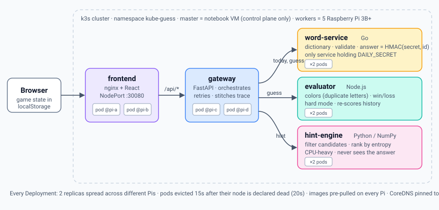

# Kube Guess

A five-letter word-guessing game that runs as five cooperating microservices on a
Kubernetes cluster of Raspberry Pis. Final project for 2110415 Software-Defined
Systems, semester 1/2026.

You get six tries to find the daily word. After each guess, every letter turns
**teal** (right letter, right spot), **amber** (in the word, wrong spot) or
**slate** (not in the word). A **Hint** button reports how many answers are
still possible and which guess would narrow them down the most. A
**Request path** panel shows which pod on which node served each hop of every
request, so you can watch the cluster at work.



```
Browser ─► frontend (nginx + React) ─► gateway (FastAPI) ─┬─► word-service (Go)    dictionary + daily answer
                                                          ├─► evaluator (Node)     scoring + game rules
                                                          └─► hint-engine (NumPy)  candidate filter + entropy
```

| Request | Containers it touches |
|---|---|
| `GET /api/today` | frontend → gateway → word-service |
| `POST /api/guess` | frontend → gateway → word-service (×2, parallel) → evaluator |
| `POST /api/hint` | frontend → gateway → hint-engine |

Every request touches at least 3 containers, and all 5 are used.

## Why it survives losing a Raspberry Pi

- **No state on the server.** The daily answer is `HMAC(secret, puzzle_id)`, so any
  word-service replica computes the same answer. The game's progress lives in the
  browser and is sent with each request.
- **Two replicas of every service, never on the same Pi**
  (`topologySpreadConstraints`, `DoNotSchedule`).
- **Fast replacement.** A silent node is declared dead after 20s instead of 40–50s,
  and its pods are evicted 15s later instead of 5 minutes.
- **Retries at every hop.** The browser, nginx and the gateway each retry on a
  new connection, which kube-proxy routes to a live replica.
- **CoreDNS is pinned to the master**, so pulling a Pi can't take out service discovery.
- **Every image is pre-pulled onto every Pi**, so replacement pods start even with no internet.

Measured on the local 6-node cluster: pulling the busiest node while requests
kept arriving gave **161 of 165 requests OK**. All 4 failures were in the first
12 seconds, and replacements were running about 30 seconds after the pull.

## Quick start (local, on a Mac)

Requirements: Docker Desktop, `kubectl`, and `k3d` (`brew install k3d`).

```bash
scripts/local-up.sh          # 1 master + 5 "Pi" nodes in Docker, build, deploy
open http://localhost:8080

scripts/where.sh             # which pod runs on which node
scripts/demo.sh              # continuous requests with their path through the cluster
scripts/node.sh kill random  # "pull a Pi"
scripts/node.sh restore all  # plug it back in
scripts/local-down.sh        # delete the cluster
```

Full walkthrough: [docs/local-testing.md](docs/local-testing.md).

## On the Raspberry Pi cluster

```bash
# master (Ubuntu VM on a notebook, bridged network)
cluster/master-install.sh
# each Pi
sudo MASTER_IP=<master-ip> cluster/pi-prep.sh pi-1 && sudo reboot
MASTER_IP=<master-ip> K3S_TOKEN=<token> cluster/join-worker.sh
# master again
scripts/set-registry.sh <github-owner>
scripts/deploy.sh pi
```

Step-by-step guide: [docs/cluster-setup.md](docs/cluster-setup.md).

## Documentation

| Document | What it covers |
|---|---|
| [docs/architecture.md](docs/architecture.md) | Why the system is split this way, statelessness, fault-tolerance design, algorithms |
| [docs/api.md](docs/api.md) | Every public and internal endpoint, with examples |
| [docs/local-testing.md](docs/local-testing.md) | Running and breaking the cluster on a laptop with k3d |
| [docs/cluster-setup.md](docs/cluster-setup.md) | Building the Raspberry Pi cluster from scratch and deploying to it |
| [docs/demo-runbook.md](docs/demo-runbook.md) | Demo-day script, mapped line by line to the grading rubric |

## Repository layout

```
services/
  frontend/       React (Vite) UI served by nginx; proxies /api to gateway
  gateway/        FastAPI entry point; orchestrates the backends, retries
  word-service/   Go; word lists, daily answer (only holder of the secret)
  evaluator/      Node/Express; scoring, duplicate letters, win/loss, hard mode
  hint-engine/    Python/NumPy; candidate filtering and entropy ranking
data/
  words/          answers.txt (873 curated), allowed.txt (12,602 guesses)
  test-vectors.json   scoring cases shared by the evaluator and hint-engine tests
k8s/
  base/           Deployments, Services, image pre-pull DaemonSet
  overlays/local  k3d (locally built images)
  overlays/pi     Raspberry Pi cluster (GHCR images)
scripts/          build, test, deploy, demo, where, node (failure simulation)
cluster/          k3s install scripts for the master VM and the Pis
.github/workflows CI: tests, then multi-arch (arm64 + amd64) images to GHCR
docker-compose.yml  run everything without Kubernetes
```

## Tests

```bash
scripts/test.sh
```

Runs the Go tests (word-service), `node --test` (evaluator) and pytest inside
Docker (gateway, hint-engine). The evaluator and hint-engine both check their
scoring against `data/test-vectors.json`, so the two implementations can't
drift apart.

## Word lists

`answers.txt` is a hand-picked list of common English words. `allowed.txt`
adds every five-letter word in Webster's Second International Dictionary
(1934, public domain, shipped as `/usr/share/dict/web2` on macOS) plus simple
plurals of its four-letter words.
